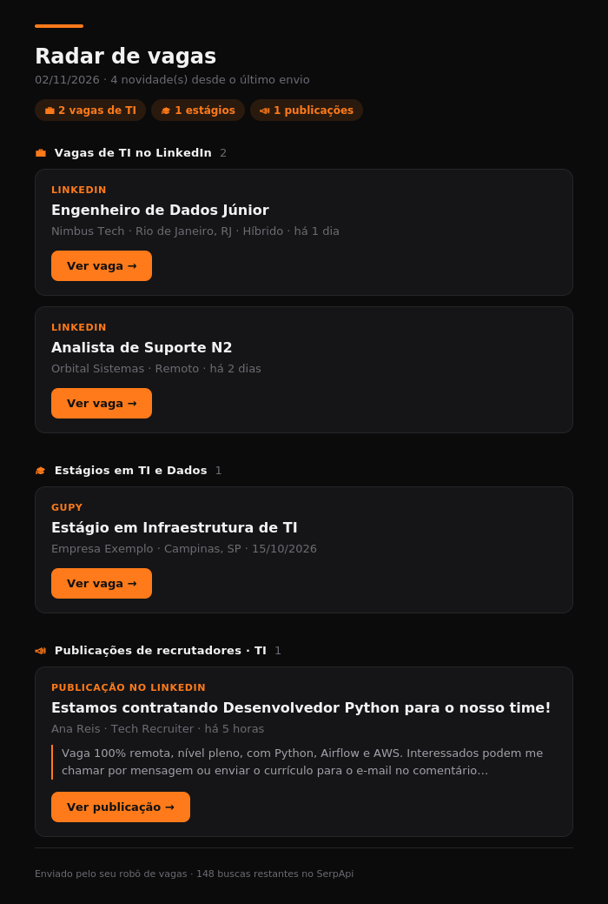
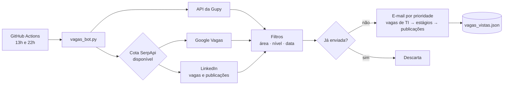

# 🎯 Radar de Vagas em TI e Dados


Automação em Python que monitora vagas de **TI de todas as áreas** (dados, desenvolvimento, infraestrutura, suporte, segurança, cloud, QA, UX, SAP e outras) e **publicações de recrutadores no LinkedIn**, além de estágios em TI na Gupy e no Google Vagas. O robô filtra o que é relevante e recente, elimina repetições e envia duas vezes por dia um e-mail em tema escuro, organizado por prioridade. Roda inteiramente na nuvem com GitHub Actions, sem servidor e sem custo.

Criei este projeto para resolver um problema meu: acompanhar várias plataformas todos os dias tomava tempo, e muitos recrutadores anunciam vagas em publicações no LinkedIn, que não aparecem nas buscas de vagas tradicionais.

<p align="center"></p>

## ✨ Funcionalidades

- **Vagas de TI no LinkedIn, de qualquer área e nível**, encontradas pelas páginas públicas indexadas pelo Google.
- **Publicações de recrutadores**: identifica posts públicos que anunciam vagas de TI (#vagas, "estamos contratando"...) e descarta os de quem está procurando emprego (#opentowork).
- **Estágios em TI e Dados** na Gupy (API pública do portal) e no Google Vagas, que agrega LinkedIn, Catho, InfoJobs, Indeed e outros.
- **Gestão automática de cota**: consulta o saldo da SerpApi e distribui as buscas até a renovação do plano, priorizando as de TI.
- **Filtros por área, nível e data**, com interpretação de datas relativas em português e inglês ("há 2 dias", "3 days ago").
- **Sem repetição**: histórico das vagas já enviadas, inclusive entre fontes diferentes.
- **E-mail em tema escuro**, com cartões, seções por prioridade, trecho das publicações e botão de acesso direto.
- **Testes automatizados** rodando a cada push.

## ⚙️ Como funciona



## 🛠️ Tecnologias

| Tecnologia | Uso |
|---|---|
| Python 3.12 | lógica do robô |
| Requests | consumo das APIs REST |
| SerpApi (Google Search e Google Jobs) | LinkedIn e agregação de Catho, InfoJobs e outros |
| HTML/CSS para e-mail | layout em tabelas com estilos inline, compatível com Gmail |
| smtplib / MIME | envio pelo Gmail |
| GitHub Actions | agendamento, execução na nuvem e integração contínua |
| unittest + mock | testes automatizados, incluindo respostas simuladas da API |

## 🧩 Desafios e decisões técnicas

**LinkedIn sem raspagem.** LinkedIn, Catho e InfoJobs bloqueiam acesso automatizado e proíbem raspagem nos termos de uso. Em vez de logar numa conta ou manter um scraper frágil, o robô consulta o índice público do Google (via SerpApi) com operadores como `site:br.linkedin.com/jobs/view` e `site:linkedin.com/posts`, filtrando pelo período recente. A contrapartida é que publicações visíveis só para conexões ficam de fora.

**Publicações que parecem vagas, mas não são.** Uma busca por "vaga" também traz posts de candidatos procurando emprego. O robô exige sinais de anúncio ("contratando", "envie seu currículo") e descarta sinais de candidato ("#opentowork", "busco oportunidade"). Termos ambíguos foram tratados com cuidado: "dados" sozinho foi trocado por expressões como "analista de dados", para não confundir com "envie seus dados".

**Orçamento de 250 buscas por mês.** São 7 buscas pagas configuradas e 60 execuções por mês, bem acima da cota gratuita. O robô consulta o saldo na API de conta da SerpApi, calcula quantas buscas cabem por execução até a renovação e escolhe quais rodar com um **round-robin ponderado**: buscas de TI têm peso maior e rodam com mais frequência, e todas rodam ao longo de poucos dias. Se o plano for ampliado, o robô passa a usar o saldo extra automaticamente.

**Mudança na API da Gupy.** Durante o desenvolvimento, a Gupy desativou o endereço antigo da API, que passou a responder 404. Identifiquei o novo endpoint pelos logs e implementei uma lista de endereços com fallback.

**Datas ausentes no Google Vagas.** A maioria dos resultados vinha sem o campo de data estruturado. Adicionei ao log a contagem de descartes por motivo, descobri que a data costumava aparecer só nas etiquetas da vaga e passei a procurá-la ali, aceitando apenas textos que indicam publicação.

**Fuso horário.** O GitHub Actions roda em UTC, o que fazia o e-mail das 22h sair com a data do dia seguinte. Datas e janelas de execução usam o horário de Brasília.

**E-mail em tema escuro.** Clientes de e-mail ignoram boa parte do CSS moderno, então o layout usa tabelas, estilos inline, `bgcolor` e a meta `color-scheme`, para o tema escuro se manter no Gmail.

## 📁 Estrutura

```
├── .github/workflows/
│   ├── vagas.yml          # agendamento (13h e 22h, horário de Brasília)
│   └── testes.yml         # testes a cada push
├── docs/
│   └── preview-email.png  # prévia do e-mail (dados fictícios)
├── tests/
│   └── test_filtros.py    # testes: filtros, LinkedIn, datas, cota e e-mail
├── vagas_bot.py           # coleta, filtros, cota, deduplicação e e-mail
├── config.json            # termos, buscas, pesos e limites
├── vagas_vistas.json      # histórico de vagas já enviadas
└── requirements.txt
```

## 🚀 Como usar

### Rodar localmente

```bash
git clone https://github.com/Reidner-Verdino/robo-vagas-estagio.git
cd robo-vagas-estagio
pip install -r requirements.txt
python vagas_bot.py --teste        # mostra as vagas no terminal, sem enviar e-mail
python -m unittest discover tests  # roda os testes
```

Sem credenciais configuradas, o robô roda em modo teste automaticamente. A Gupy funciona sem nenhuma chave; LinkedIn e Google Vagas exigem a chave da SerpApi.

### Rodar na nuvem com envio de e-mail

1. Faça um fork deste repositório (pode ser privado).
2. Gere uma [senha de app do Gmail](https://myaccount.google.com/apppasswords) (exige verificação em duas etapas) e uma chave gratuita da [SerpApi](https://serpapi.com).
3. Em **Settings → Secrets and variables → Actions**, cadastre os segredos:

| Segredo | Valor |
|---|---|
| `EMAIL_REMETENTE` | Gmail que envia as vagas |
| `EMAIL_SENHA_APP` | senha de app de 16 letras |
| `EMAIL_DESTINO` | e-mail que recebe (opcional, padrão é o remetente) |
| `SERPAPI_KEY` | chave da SerpApi |

4. No `config.json`, ajuste `serpapi_dia_renovacao` para o dia do mês em que sua cota da SerpApi renova.
5. Na aba **Actions**, abra **Vagas de estágio** e clique em **Run workflow** para testar.

As credenciais ficam criptografadas nos segredos do GitHub e nunca aparecem no código nem nos logs.

## 🔧 Configuração

Tudo fica no `config.json`:

| Campo | O que controla |
|---|---|
| `termos_ti_amplo` | o que conta como TI nas vagas e publicações do LinkedIn |
| `termos_sinal_vaga` / `termos_candidato` | o que indica anúncio de vaga ou alguém procurando emprego |
| `termos_estagio` / `termos_area` / `termos_excluir` | filtros dos estágios (Gupy e Google Vagas) |
| `linkedin_buscas` | consultas do LinkedIn e seus pesos de prioridade |
| `gupy_termos` / `google_consultas` | o que é pesquisado em cada fonte |
| `linkedin_dias_maximos` / `google_dias_maximos` / `dias_maximos` | idade máxima das vagas por fonte |
| `serpapi_dia_renovacao` / `execucoes_por_dia` | base do cálculo de cota por execução |

Os horários ficam em `.github/workflows/vagas.yml`, no formato cron em UTC (3 horas à frente de Brasília).

## 🗺️ Próximos passos

- Novas fontes (Programathor, Vagas.com, portais de empresas)
- Envio também pelo Telegram
- Painel com estatísticas das vagas coletadas (empresas, cidades, tecnologias mais pedidas)

## 👤 Autor

**Reidner Verdino** · [GitHub](https://github.com/Reidner-Verdino)

Licenciado sob a [Licença MIT](LICENSE).
