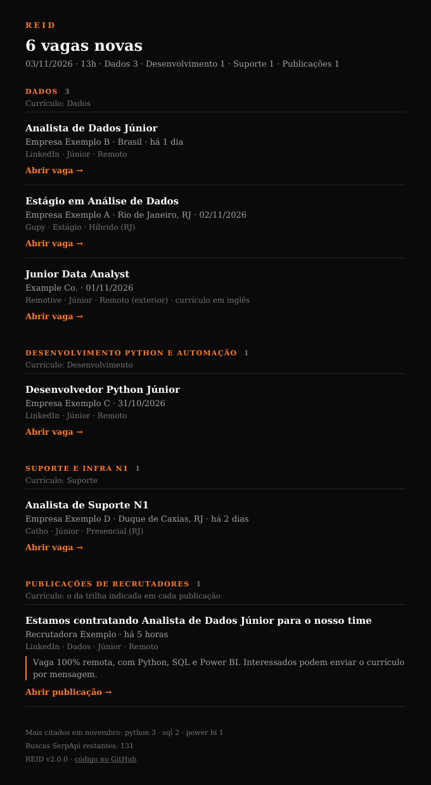
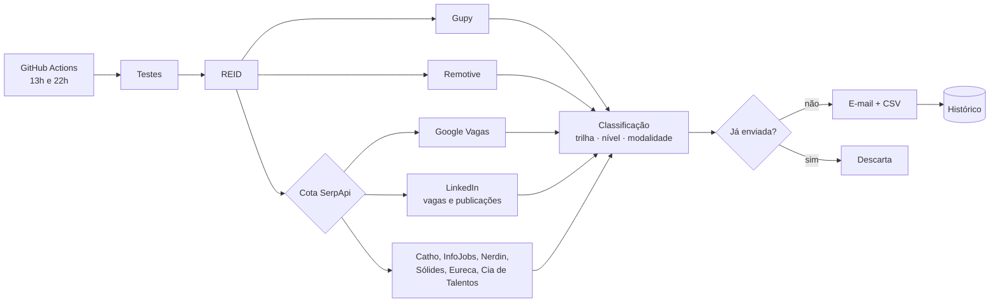

# REID · Radar de Empregos e Inteligência de Dados


[English version](README_EN.md)

O REID é uma automação em Python que procura vagas de primeira oportunidade em tecnologia (estágio e júnior) em 10 fontes, classifica cada uma por **trilha**, **nível** e **modalidade**, indica qual currículo usar e envia um e-mail organizado por prioridade **duas vezes por dia, às 13h e às 22h**. Roda sozinho no GitHub Actions, sem servidor e sem custo.

Criei o projeto para trocar horas de busca manual em vários sites por alguns minutos de leitura de um e-mail, e para acompanhar as vagas que recrutadores anunciam apenas em publicações no LinkedIn.

<p align="center"></p>

## O que o REID faz

| Etapa | Como |
|---|---|
| Coleta | Gupy (API pública), LinkedIn (vagas e publicações de recrutadores), sites prioritários via buscador (Catho, InfoJobs, Nerdin, Sólides, Eureca e Cia de Talentos), Google Vagas (agrega outros sites) e Remotive (remoto no exterior) |
| Classificação | Trilha: Dados, Desenvolvimento Python e Automação, Suporte e Infra N1 ou TI geral. Nível: estágio ou júnior. Modalidade: remoto no Brasil, remoto no exterior (Worldwide ou LATAM) ou híbrido e presencial em cidades de fácil acesso do Grande Rio, com prioridade para o Centro |
| Prioridade | Pontuação por trilha (Dados primeiro), nível, modalidade e recência |
| Entrega | E-mail minimalista com o currículo indicado em cada seção e uma planilha CSV anexa no formato de controle de candidaturas |
| Memória | Histórico de vagas já enviadas (nunca repete) e estatística mensal das tecnologias mais pedidas |

Vagas sem "estágio" ou "júnior" no título, trainee, nível pleno ou acima, de outras áreas, presenciais fora da região ou de países que não aceitam candidatos do Brasil são descartadas, e o motivo de cada descarte aparece no log.

## Como funciona



## Tecnologias

| Tecnologia | Uso |
|---|---|
| Python 3.12 | todo o robô, organizado em pacote com módulos por responsabilidade |
| Requests | APIs REST, com novas tentativas em falhas temporárias |
| SerpApi (DuckDuckGo e Google Jobs) | LinkedIn e agregação de vagas de outros sites |
| HTML e CSS para e-mail | layout em tabelas com estilos inline, compatível com o Gmail |
| smtplib e MIME | envio pelo Gmail com anexo CSV |
| GitHub Actions | agendamento, execução na nuvem e integração contínua |
| unittest e mock | 130 testes automatizados, sem acesso à internet |

## Decisões técnicas

**LinkedIn e sites de vagas sem raspagem.** Os termos de uso do LinkedIn e de vários sites de vagas proíbem robôs. Para o Catho, InfoJobs, Nerdin, Sólides, Eureca e Cia de Talentos, o REID faz o mesmo que no LinkedIn: busca no índice público, restrita ao domínio de cada site, e descarta páginas de listagem. Esses sites e a Gupy também ganham prioridade na ordenação. O REID consulta o índice público de um buscador, restrito a páginas `br.linkedin.com/jobs/view` e `linkedin.com/posts`, e confere no código se cada resultado é mesmo do LinkedIn. O Google ignorava a restrição `site:` em buscas de emprego, então o motor padrão é o DuckDuckGo; o motor é configurável.

**Uma única regra de classificação.** Todas as fontes entregam dados brutos e passam pela mesma função, na mesma ordem de regras. Assim, um critério nunca vale em uma fonte e não em outra, e cada descarte tem um motivo registrado.

**Cota de 250 buscas por mês.** O REID consulta o saldo real da conta, divide pelo número de execuções até a renovação e escolhe as buscas com um round-robin ponderado: as de maior prioridade rodam mais vezes, e todas rodam ao longo de poucos dias.

**Rigidez contra erros.** O `config.json` é validado por completo antes de cada execução. Um histórico corrompido interrompe a execução em vez de ser tratado como vazio, o que reenviaria tudo. O histórico só é salvo depois que o e-mail é enviado. O workflow roda os testes antes do robô e impede duas execuções simultâneas. Uma fonte fora do ar não derruba as outras, e a falha aparece no e-mail e na aba Actions.

**Mudança de API e dados incompletos.** Quando a Gupy desativou o endereço antigo da API, o log mostrou o erro e o REID passou a usar uma lista de endereços com reserva. Quando o Google Vagas deixou de informar a data no campo próprio, o REID passou a ler a data nas etiquetas da vaga, aceitando só textos que indicam publicação.

## Estrutura

```
├── reid/
│   ├── principal.py       execução completa e linha de comando
│   ├── classificacao.py   trilha, nível, modalidade, alertas e pontuação
│   ├── config.py          validação estrita do config.json
│   ├── cota.py            distribuição da cota da SerpApi
│   ├── historico.py       vagas enviadas e estatísticas mensais
│   ├── relatorio.py       e-mail (HTML e texto), assunto e CSV
│   ├── envio.py           SMTP do Gmail
│   ├── rede.py            requisições com novas tentativas
│   ├── texto.py           normalização, termos e datas
│   └── fontes/            gupy, linkedin, sites, google_vagas, remotive, serpapi
├── tests/                 130 testes
├── docs/                  documentação técnica, guia de carreira e guia de atualização
├── config.json            termos, trilhas, fontes e limites
└── .github/workflows/     vagas.yml (agendamento) e testes.yml
```

## Como usar

```bash
git clone https://github.com/Reidner-Verdino/robo-vagas-estagio.git
cd robo-vagas-estagio
pip install -r requirements.txt
python -m unittest discover -s tests        # testes
python -m reid --validar                    # valida o config.json
python -m reid --teste --previa previa.html # busca sem enviar e grava o e-mail em HTML
```

Para receber os e-mails, faça um fork (pode ser privado), cadastre em **Settings → Secrets and variables → Actions** os segredos `EMAIL_REMETENTE`, `EMAIL_SENHA_APP` (senha de app do Gmail), `EMAIL_DESTINO` (opcional) e `SERPAPI_KEY`, ajuste `serpapi.dia_renovacao` no `config.json` e rode **Actions → REID → Run workflow**. Sem as credenciais, o REID roda em modo teste: busca e classifica, mas não envia nem salva nada.

## Documentação

- [Documentação técnica](docs/DOCUMENTACAO_TECNICA.md): regras de classificação, referência do `config.json`, log e solução de problemas.
- [Guia de carreira](docs/GUIA_DE_CARREIRA.md): como o REID entra na rotina de candidaturas, textos para LinkedIn, currículo e Gupy, e preparação para entrevistas.
- [Como atualizar o GitHub](docs/COMO_ATUALIZAR_O_GITHUB.md): passo a passo para publicar alterações.
- [Histórico de versões](CHANGELOG.md).

## Autor

**Reidner Verdino** · [GitHub](https://github.com/Reidner-Verdino) · [LinkedIn](https://www.linkedin.com/in/reidnervedino)

Licença [MIT](LICENSE). As vagas da Remotive são exibidas com a fonte e o link da própria Remotive, como a API pede.
