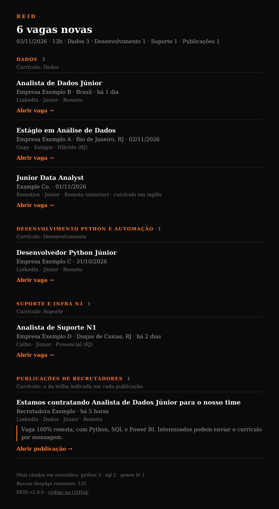

# REID · Recruitment Engine for IT and Data


[Versão em português](README.md)

REID is a Python automation that finds entry-level tech openings (internship and junior) across 10 sources, classifies each one by **track**, **level** and **work model**, tells which résumé to use and emails a prioritized digest **twice a day, at 1 p.m. and 10 p.m. (Brazil time)**. It runs on its own on GitHub Actions, with no server and no cost.

I built it to replace hours of manual searching across job boards with a few minutes of reading one email, and to keep track of openings that recruiters only announce in LinkedIn posts.

<p align="center"></p>

## What REID does

| Step | How |
|---|---|
| Collect | Gupy (public API), LinkedIn (job pages and recruiter posts), priority job boards through a search engine (Catho, InfoJobs, Nerdin, Sólides, Eureca and Cia de Talentos), Google Jobs (aggregates other boards) and Remotive (remote jobs abroad) |
| Classify | Track: Data, Python Development and Automation, IT Support (L1) or general IT. Level: internship or junior. Work model: remote in Brazil, remote abroad (Worldwide or LATAM), or hybrid and on-site in easy-to-reach cities of Greater Rio, with priority for downtown Rio |
| Prioritize | Score by track (Data first), level, work model and recency |
| Deliver | Minimal email with the suggested résumé per section and an attached CSV in a job-application tracker format |
| Remember | History of jobs already sent (never repeats) and a monthly count of the most requested technologies |

Roles without "internship" or "junior" in the title, trainee, mid-level or senior roles, other fields, on-site roles outside the region and countries that don't hire from Brazil are discarded, and the reason for each discard is logged.

## Technical decisions

**LinkedIn and job boards without scraping.** The terms of LinkedIn and several job boards forbid bots. For Catho, InfoJobs, Nerdin, Sólides, Eureca and Cia de Talentos, REID does the same as for LinkedIn: it searches the public index restricted to each board's domain and drops listing pages. These boards and Gupy also get priority in the ranking. REID queries a search engine's public index restricted to `br.linkedin.com/jobs/view` and `linkedin.com/posts`, and checks in code that every result really comes from LinkedIn. Google ignored the `site:` restriction for job searches, so the default engine is DuckDuckGo; the engine is configurable.

**One classification rule.** Every source returns raw data that goes through the same function, in the same rule order. A criterion never applies to one source and not to another, and every discard has a logged reason.

**A 250-searches-per-month quota.** REID reads the real account balance, divides it by the runs left until renewal and picks searches with a weighted round-robin: higher-priority searches run more often, and all of them run within a few days.

**Built to avoid mistakes.** `config.json` is fully validated before every run. A corrupted history stops the run instead of being treated as empty, which would resend everything. History is saved only after the email is sent. The workflow runs the tests before the bot and prevents concurrent runs. One source being down never stops the others, and the failure shows up in the email and in the Actions tab.

**API changes and incomplete data.** When Gupy shut down its old API address, the logs showed it and REID moved to a list of endpoints with a fallback. When Google Jobs stopped filling its date field, REID started reading the date from the job's tags, accepting only text that indicates a posting date.

## Stack

Python 3.12 · Requests · SerpApi (DuckDuckGo and Google Jobs) · HTML email · smtplib · GitHub Actions · unittest with mocks (130 tests, no network access).

## Usage

```bash
git clone https://github.com/Reidner-Verdino/robo-vagas-estagio.git
cd robo-vagas-estagio
pip install -r requirements.txt
python -m unittest discover -s tests
python -m reid --validar
python -m reid --teste --previa preview.html
```

To receive the emails, fork the repository (it can be private), add the secrets `EMAIL_REMETENTE`, `EMAIL_SENHA_APP` (a Gmail app password), `EMAIL_DESTINO` (optional) and `SERPAPI_KEY` under **Settings → Secrets and variables → Actions**, set `serpapi.dia_renovacao` in `config.json` and run **Actions → REID → Run workflow**. Without credentials REID runs in test mode: it searches and classifies, but neither sends nor saves anything.

## Author

**Reidner Verdino** · [GitHub](https://github.com/Reidner-Verdino) · [LinkedIn](https://www.linkedin.com/in/reidnervedino)

MIT [license](LICENSE). Remotive jobs are shown with Remotive as the source and a link back to Remotive, as its API requests.
